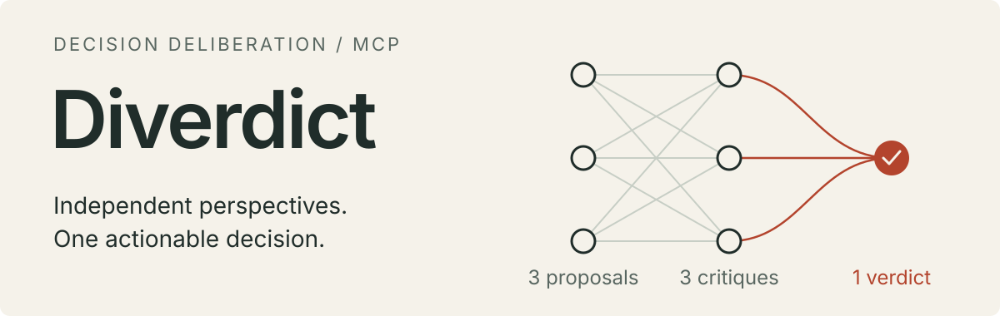

<p align="center">
  
</p>

<p align="center">
  <a href="README.md">中文</a> ·
  <a href="#installation">Installation</a> ·
  <a href="docs/delivery/pilot-result.md">Real example</a> ·
  <a href="docs/README.md">Documentation</a> ·
  <a href="CONTRIBUTING.md">Contributing</a>
</p>

**Diverdict is an MCP server that turns independent perspectives into actionable decisions.** A strategist examines time and positioning, a diplomat examines relationships and interests, and a schemer examines risk. They propose independently and question each other's proposals. Jia Xu then delivers a final strategy and its weakest point.

The host supplies the model and execution capabilities. **Local stdio · No built-in model API · No telemetry · MIT**

## Installation

Source installation requires **Git, Node.js 22+, and npm**. The host must support local stdio MCP and isolated instances of the same model without inherited history, tools, file access, or network access. MCP connectivity alone is insufficient for the full workflow.

### Build and verify

The installation directory and Node executable must remain accessible to the host. For an existing checkout, start at `npm ci`. Each command must succeed before the next step.

```sh
git clone https://github.com/HJSunDev/diverdict.git
cd diverdict
node --version
npm ci
npm run build
npm run smoke
```

Successful smoke output includes `PASS: stdio handshake, tools/list, three-stage 3+3+1 flow`. The smoke test uses fixtures and makes no model calls. Source and local `.tgz` installation are supported; the package is not yet published to the public npm registry.

### Register with Codex

Run from the repository root. These commands resolve absolute paths automatically and support spaces. Reuse valid existing configuration.

**PowerShell**

```powershell
$diverdictNode = node -p "process.execPath"
$diverdictEntry = node -p "require('node:path').resolve('dist/cli.js')"
codex mcp add diverdict -- "$diverdictNode" "$diverdictEntry"
codex mcp get diverdict --json
```

**Bash / Zsh**

```sh
diverdict_node="$(node -p 'process.execPath')"
diverdict_entry="$(node -p 'require("node:path").resolve("dist/cli.js")')"
codex mcp add diverdict -- "$diverdict_node" "$diverdict_entry"
codex mcp get diverdict --json
```

This writes Codex user-level configuration. See [client setup](docs/engineering/clients.md) for project-level configuration, setup without a CLI, and other hosts. The host starts the stdio process; no separate persistent terminal is needed. Model authentication and quota come from the host, with no additional API key.

After registration, refresh the tool catalog and verify that `strategize_begin`, `strategize_submit`, and `strategize_verdict` are callable, using any host-specific prefixes. Open a new task or restart the client if refresh is unavailable. `mcp get` verifies configuration and the source smoke test verifies the protocol; neither establishes connectivity in the current host.

## Execution protocol

`strategize_begin` requires both `problem` and a nonblank `context`. Background includes relevant goals, options, constraints, preferences, facts, and the latest corrections from available conversation and already-read material. Resolve references and distinguish facts, assumptions, and unknowns. File paths, URLs, and “see above” cannot replace the material itself.

State explicitly when no additional background is known. Clarify material gaps unless the user requests a decision with available information; then identify unknowns and proceed. Exclude full conversation logs, host instructions, and predetermined conclusions.

**Make all three calls on the same MCP connection, preserving the returned `session_id`:**

| Call | Arguments | Host execution |
| --- | --- | --- |
| `strategize_begin` | `problem`, `context`; optional `request_id` | Run 3 proposal jobs in parallel |
| `strategize_submit` | `session_id`, `proposals` | Run 3 critique jobs in parallel |
| `strategize_verdict` | `session_id`, `critiques` | Run the `arbiter` job; return the strategy and its weakest point |

The workflow uses **3 + 3 + 1 generations** of the same model, with no discussion loop or dynamic rerouting.

Both `proposals` and `critiques` map `job.role` to complete original outputs, using the keys `strategist`, `diplomat`, and `schemer`. Finish every job in a round before advancing.

For successful responses, read `structuredContent` or parse the equivalent JSON text if unavailable. `instructions` are for the host. Each fresh isolated instance receives only its job's unchanged `system_prompt` and `user_prompt`, without host history or other jobs. Without a separate system channel, place the identity in instance instructions and preserve its priority. Critiques must not see one another.

**`next_tool: null` still requires generating the arbiter's final answer.** The last tool returns a job, not a verdict. There is no fourth tool call.

Tool errors do not enter generation. Retries reuse the original request and material; connection changes, restarts, and expiry require a new session. Oversized outputs cannot be truncated or replaced with summaries. See the [full protocol](docs/architecture/protocol.md) for limits, JSON examples, and error recovery.

## Real example

A two-person team has a working prototype and six weeks. **Serve three interested customers first, or launch publicly?**

In a real Codex / GPT-6 Astra run, the final strategy opened with this decision (translated excerpt):

> Start with a limited pilot, and begin seeking customers beyond the original three in week one. Do not make a full public launch mandatory within six weeks. Two weeks spent on documentation and self-service installation must be justified by recurring delivery obstacles.

> The weakest point is whether this market's purchasing and usage cycles can fit within six weeks.

[Read the original verdict →](docs/delivery/pilot-result.md) · [Input](examples/pilot-decision.json) · [Validation conditions](docs/delivery/validation.md)

This is one real output, not a general quality benchmark. The validation record also documents incomplete overlap in the host's second-round scheduling.

## Core and data

[`advisors.md`](docs/product/advisors.md) is the canonical source for roles and workflow discipline. It is loaded directly at runtime and protected by a SHA-256 integrity test. Material marked as future speculation is excluded from runtime prompts.

The server assembles prompts and advances the workflow. It does not call models, execute commands, or write decision logs. It includes no UI, persistent memory, multi-model routing, or configurable role packs.

Each connection holds at most 32 in-memory sessions, expiring two hours after creation. Subsequent requests remove expired entries. Process exit loses all material; the host's own conversation retention policy still applies.

`docs/origin/HANDOFF.md` is the original design handoff in the source repository and is excluded from the npm package.

## Development and contributing

```sh
npm ci
npm run check          # Types, formatting, static checks, and protocol tests
npm run test:coverage  # Node's built-in coverage report
npm run package:check  # Pack, install independently, and smoke-test the protocol
```

CI covers Windows, Linux, macOS, and Node.js 22/24. Tests verify core integrity, isolated material, workflow, state and resource bounds, CLI behavior, and modern and older MCP client handshakes.

[Contributing](CONTRIBUTING.md) · [Evaluation](docs/engineering/evaluation.md) · [Architecture](docs/architecture/README.md) · [Security](SECURITY.md) · [Releases](docs/engineering/releasing.md) · [Changelog](CHANGELOG.md)

---

[MIT](LICENSE), including the code, role prompts, and workflow documents.
