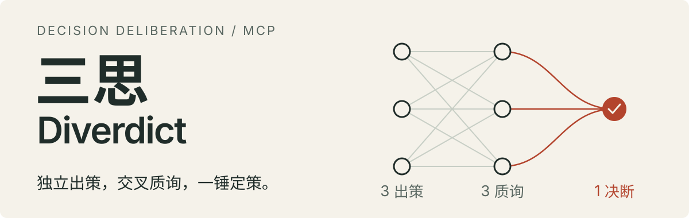

<p align="center">
  
</p>

<p align="center">
  <a href="README.en.md">English</a> ·
  <a href="#安装">安装</a> ·
  <a href="docs/delivery/pilot-result.md">真实案例</a> ·
  <a href="docs/README.md">文档</a> ·
  <a href="CONTRIBUTING.md">参与贡献</a>
</p>

**三思（Diverdict）是一个把独立视角转化为行动方略的 MCP 服务。** 战略家看时间，纵横家看关系，阴谋家看风险；三家独立出策、交叉质询，再由贾诩给出最终方略，指出其中最脆弱的一环。

模型与执行能力由宿主提供。**本地 stdio · 无内置模型 API · 无遥测 · MIT**

## 安装

源码安装需要 **Git、Node.js 22+ 和 npm**。宿主须支持本地 stdio MCP，以及同模型、无历史继承、无工具 / 文件 / 网络权限的隔离生成。仅有 MCP 连接能力不足以执行完整流程。

### 构建与验证

安装目录和 Node 必须能被宿主持续访问。已有 checkout 可从 `npm ci` 开始；各命令成功后再执行下一步。

```sh
git clone https://github.com/HJSunDev/diverdict.git
cd diverdict
node --version
npm ci
npm run build
npm run smoke
```

烟测成功输出 `PASS: stdio handshake, tools/list, three-stage 3+3+1 flow`，使用测试夹具，不调用模型。当前支持源码或本地 `.tgz` 安装，尚未发布到公共 npm registry。

### 注册到 Codex

在仓库根目录执行。命令自动解析绝对路径，支持路径含空格；已有有效配置可复用。

**PowerShell**

```powershell
$diverdictNode = node -p "process.execPath"
$diverdictEntry = node -p "require('node:path').resolve('dist/cli.js')"
codex mcp add diverdict -- "$diverdictNode" "$diverdictEntry"
codex mcp get diverdict --json
```

**Bash / Zsh**

```sh
diverdict_node="$(node -p 'process.execPath')"
diverdict_entry="$(node -p 'require("node:path").resolve("dist/cli.js")')"
codex mcp add diverdict -- "$diverdict_node" "$diverdict_entry"
codex mcp get diverdict --json
```

以上写入 Codex 用户级配置。项目级配置、无 CLI 配置及其他宿主见[接入指南](docs/engineering/clients.md)。stdio 进程由宿主启动，无需另行常驻运行；模型认证与额度由宿主提供，无需额外 API key。

注册后刷新工具目录，确认 `strategize_begin`、`strategize_submit`、`strategize_verdict` 可调用；工具前缀以宿主实际目录为准。不支持刷新时新开任务或重启客户端。`mcp get` 只验证配置，源码烟测只验证协议，均不代表当前宿主已接通。

## 调用协议

`strategize_begin` 的 `problem` 与非空 `context` 均为必填。背景应包含已有对话及已读材料中的相关目标、选项、约束、偏好、事实与最新更正，展开指代，区分事实、推测与未知。文件路径、链接或“见上文”不能代替实际材料。

确无额外背景时明确说明；关键缺失才澄清，用户要求直接判断时注明未知后继续。背景不包含整段历史、宿主指令或预设结论。

**在同一 MCP 连接中完成三次调用，并保留返回的 `session_id`：**

| 调用 | 参数 | 宿主执行 |
| --- | --- | --- |
| `strategize_begin` | `problem`、`context`；可选 `request_id` | 并行执行 3 个出策 job |
| `strategize_submit` | `session_id`、`proposals` | 并行执行 3 个质询 job |
| `strategize_verdict` | `session_id`、`critiques` | 执行 `arbiter` job，返回最终方略与最脆弱的一环 |

共 **3 + 3 + 1 次生成**，使用同一个模型，无讨论循环或动态打回。

`proposals` 和 `critiques` 均按 `job.role` 收集完整原文，包含 `strategist`、`diplomat`、`schemer` 三个键。每轮全部完成后才进入下一阶段。

成功响应优先读取 `structuredContent`，未提供时解析等价的 JSON 文本。`instructions` 供宿主执行；每个新的隔离实例只接收对应 job 的 `system_prompt` 和 `user_prompt` 原文，不继承宿主历史或其他 job。无独立 system 通道时，将身份置于实例指令并保留其优先级。三家质询互不可见。

**`next_tool: null` 后仍需生成贾诩的最终答案。** 最后一个工具返回任务，不返回结论；无第四次工具调用。

工具错误不进入生成流程。重试复用原请求及原文；更换连接、重启或过期后重新 begin。超限结果不得截断或以摘要替代。字段限制、JSON 示例和错误恢复见[完整协议](docs/architecture/protocol.md)。

## 真实案例

两人团队，有可用原型，只有六周：**先服务三家意向客户，还是先公开发布？**

Codex / GPT-6 Astra 实测结果（节选）：

> **先做受限试点，第一周就同步寻找原有三家之外的客户；六周内不把完整公开发布列为必做项。** 两周的文档与自助安装投入，必须由实际交付中的重复障碍来证明必要性。

> **最脆弱的一环，是这个市场的购买与使用周期能否装进六周。**

[阅读完整方略 →](docs/delivery/pilot-result.md) · [查看输入](examples/pilot-decision.json) · [查看验证条件](docs/delivery/validation.md)

这是一次真实输出，不是通用效果基准。验证记录同时保留了宿主在第二轮未完全并行的调度观察。

## 核心与数据

[`advisors.md`](docs/product/advisors.md) 是角色与工作纪律的唯一来源，运行时直接读取，完整性由 SHA-256 测试验证。其中标记为未来推演的内容不进入运行提示词。

服务仅拼装提示词和推进流程，不调用模型、不执行命令、不写决策日志。无 UI、长期记忆、多模型路由或可配置角色阵容。

每条连接最多保留 32 个内存会话，自创建起 2 小时有效，后续请求清理过期数据。进程退出即丢失材料；宿主自身的对话保存策略仍然适用。

源码中的 `docs/origin/HANDOFF.md` 为原始设计交接记录，不随 npm 包分发。

## 开发与贡献

```sh
npm ci
npm run check          # 类型、格式、静态检查及协议测试
npm run test:coverage  # Node 内置覆盖率
npm run package:check  # 打包、独立安装与完整协议烟测
```

CI 覆盖 Windows、Linux、macOS 与 Node.js 22/24。测试验证原文完整性、隔离材料、工作流、状态与资源边界、CLI 及新旧 MCP 客户端握手。

[贡献指南](CONTRIBUTING.md) · [效果评估](docs/engineering/evaluation.md) · [架构](docs/architecture/README.md) · [安全政策](SECURITY.md) · [发布指南](docs/engineering/releasing.md) · [更新记录](CHANGELOG.md)

---

[MIT](LICENSE) · 代码、角色提示词与工作流程文档一并适用。
