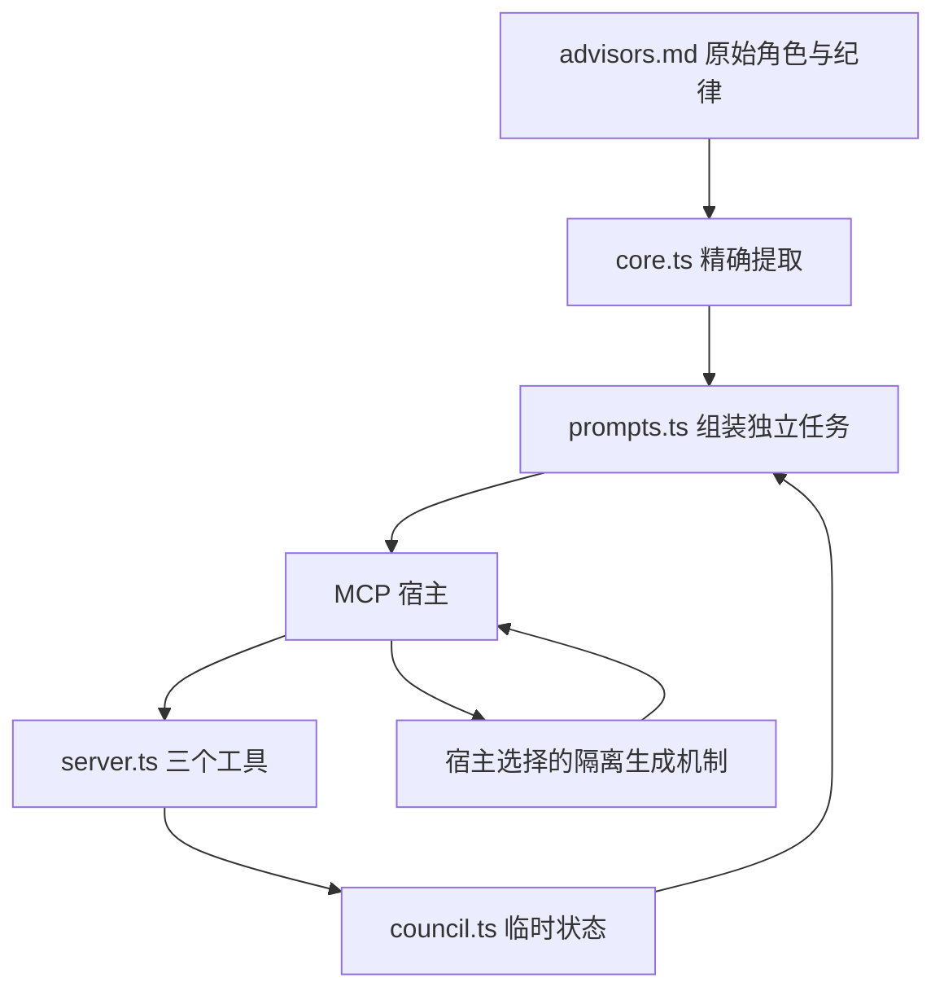

# 架构与边界

## 数据流



## 代码职责

| 文件 | 职责 |
| --- | --- |
| `core.ts` | 读取角色原文和纪律，不读取未来推演为执行指令 |
| `contracts.ts` | MCP 数据结构、字段边界、领域错误 |
| `prompts.ts` | 同一组资产拼装三个阶段的独立 job |
| `council.ts` | 连接内状态、材料归属、重试、冲突和过期 |
| `server.ts` | MCP 工具注册、schema、协议错误转换 |
| `cli.ts` | stdio 启动、版本与帮助 |

无数据库、HTTP 服务、模型 SDK、API key、命令执行器或遥测。运行时依赖仅官方 MCP server SDK 和 Zod（SDK 本身也依赖 Zod）。客户端 SDK 仅用于开发验证。

## 保持核心不变

运行时从 `docs/product/advisors.md` 读取四段 Markdown 引文，去除 `>` 展示标记，保持字句、标点与段落不变。工作纪律按原文加入质询与收敛任务。身份之外的文字只描述本轮任务和材料归属，不增加思考清单、输出模板或动态流程。

原始文档的 SHA-256：

```text
e9ec6b4917bd95fb34e9fb53742aea61fee1923cc6788478e3fffa352172a22a
```

`.gitattributes` 保留两份历史核心文档的原始字节；常规格式化命令不处理它们。未来若明确决定修改核心，需要独立评审和更新完整性测试，不能通过自动重写基准掩盖变化。

## 三拍中的隔离

出策实例只收到自己的身份和用户材料。质询实例收到自己的身份、用户材料及三份初始方略；**不注入别家本轮质询**。贾诩收到四类材料：问题、背景、三家方略、三家质询。

“因被击中才修订”保留原文，但固定三拍不额外增加回传质询或二次修订的轮次。质询中可以因已呈上的其他方略暴露自身问题而修订，服务不会要求实例回应尚未出现的攻击。

宿主必须使用同一模型和互相隔离、无工具权限的实例。服务表达规则，不枚举宿主实现，不检测其诚实程度。状态校验仅保证材料因果关系：没收到方略，便没有质询输入。

## 生命周期与规模

每个 MCP 连接对应一个 Council。状态只在 Node.js 内存中，默认最多 32 个会话；输入字段有长度上限。过期清理在下一次调用发生，进程退出时由操作系统回收全部内存。此设计用于个人本地 stdio 场景，不把单用户进程伪装成多租户服务。

最终工具交付的是贾诩 job，服务不声称模型工作已完成，也不收集最终方略。并行性发生在宿主执行层，服务自身不偷偷发出生成请求。

## 后续演进

将来更换隔离生成机制时，保留角色、纪律、材料拼装。特定宿主 CLI 编排或未来 sampling 都可以利用相同 job，但不会为尚未落实的能力提前添加抽象框架。首版不依赖未来规范承诺。
